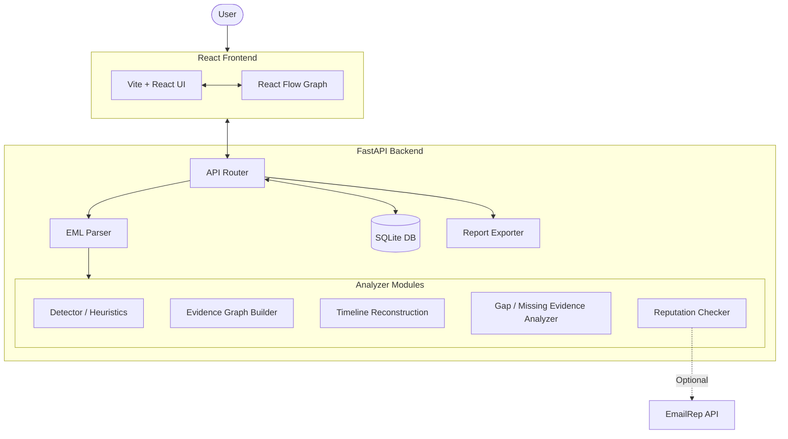

# EviPhish
> **Evidence-first phishing email forensics and analysis platform.**


EviPhish is a forensics and analysis platform that takes an **evidence-first** approach to analyzing raw RFC 5322 (`.eml`) emails. Instead of treating phishing detection as a black box, EviPhish decomposes emails into discrete, traceable pieces of evidence (headers, URLs, attachments), performs static heuristics, and builds an interactive evidence graph. This transparency helps analysts understand *why* an email is suspicious.

*Note: EviPhish is a local portfolio project and is not intended to be a validated commercial-grade security detector.*

---

## 🚀 Features

- **.eml Email Upload & Parsing**: Robust extraction of email artifacts from raw `.eml` files.
- **Header & Authentication Analysis**: Inspection of SPF, DKIM, and DMARC results alongside routing headers.
- **URL, Domain, Sender, Reply-To, and Return-Path Analysis**: Extraction and correlation of critical email entities.
- **Attachment Metadata & SHA256 Hashes**: Extraction of attachment names, sizes, types, and computed cryptographic hashes.
- **Evidence-Linked Phishing Indicators & Verdicts**: Deterministic heuristics that classify emails as `LIKELY_PHISHING`, `SUSPICIOUS`, `INCONCLUSIVE`, or `NO_STRONG_INDICATORS_DETECTED`.
- **Interactive Evidence Graph**: Visual mapping of extracted entities using React Flow.
- **Attack Timeline Reconstruction**: Chronological ordering of the email's traversal and potential attack stages.
- **Missing-Evidence Analysis**: Identification of absent but expected artifacts (e.g., missing authentication headers).
- **Forensic Report Export**: Generation of detailed JSON analysis reports.
- **Email-Address Reputation Checking (Optional)**: Integration with EmailRep for external reputation lookup (requires a configured API key).

---

## 🏗 Architecture

EviPhish consists of a decoupled frontend and backend.



---


## 🛠 Setup & Installation (Windows PowerShell)

### Prerequisites
- **Python** (version 3.10+ recommended)
- **Node.js** (version 18+ recommended)
- **Git**

### 1. Clone the Repository
```powershell
git clone https://github.com/sumayyaep/EviPhish.git
cd EviPhish
```

### 2. Backend Setup
The backend is built with FastAPI and runs on Python. From the `D:\EviPhish` directory:

```powershell
# Navigate to the backend directory
cd backend

# Create a Python virtual environment
python -m venv .venv

# Activate the virtual environment
.venv\Scripts\Activate.ps1

# Install required dependencies
pip install -r requirements.txt

# Start the FastAPI server
uvicorn app.main:app --reload --port 8000
```
- **API Base URL**: `http://localhost:8000`
- **Interactive API Docs (Swagger UI)**: `http://localhost:8000/docs`

### 3. Frontend Setup
The frontend is built with React, Vite, Tailwind CSS, and TypeScript. Open a *new* PowerShell terminal:

```powershell
# Navigate to the frontend directory
cd frontend

# Install dependencies using npm.cmd (Windows)
npm.cmd install

# Start the Vite development server
npm.cmd run dev
```
- **Local Application URL**: `http://localhost:5173`

### 4. Configuration (Optional)
To enable the **Email-Address Reputation Checking** feature, you must configure the `EMAILREP_API_KEY`.
1. Copy the `.env.example` file to `.env` in the root `D:\EviPhish` directory.
2. Edit `.env` and add your API key safely without exposing it in the repository:
```env
EMAILREP_API_KEY=your_actual_api_key_here
```
*Note: Live reputation lookups will not function until a valid API key is configured.*

---

## 🧪 Testing

The backend includes a comprehensive pytest suite.
To run the tests, activate your backend virtual environment and execute:

```powershell
cd backend
pytest
```
**Latest Reported Test Run**:
- **Backend**: `47 passed`
- **Frontend Lint**: `0 warnings and 0 errors`
- **Frontend Build**: `Successful production build`

*(Note: These results reflect the most recent reported local run. Future changes may affect these results.)*

---

## ⚠️ Limitations

- **Heuristics Are Not Proof**: Deterministic heuristics evaluate indicators but do not definitively prove an email is malicious or safe.
- **Synthetic Data**: Synthetic fixture test results do not establish or guarantee real-world detection accuracy.
- **External Dependency**: EmailRep live reputation checks require a valid API key.
- **Static Analysis Only**: EviPhish performs static analysis. It does *not* visit extracted URLs, detonate attachments in a sandbox, or execute potentially malicious payloads.
- **Data Dependency**: The accuracy of the results heavily depends on the provided `.eml` data and the availability of authentication headers or telemetry evidence.
- **Project Scope**: This is a local portfolio project for educational and demonstration purposes, not a replacement for a production security platform.

---

## 🔒 Security & Privacy

- **Local Processing**: By default, `.eml` files are parsed and analyzed entirely locally.
- **Environment Variables**: Never commit your `.env` file to version control. The repository is configured to ignore it via `.gitignore`.
- **Handling Real Evidence**: Exercise caution when uploading and analyzing real phishing emails containing potentially live malicious URLs or dangerous attachments on your local machine.

## 🤝 Contributing

Contributions are welcome! Please feel free to submit a Pull Request if you'd like to improve the heuristics, add new parsers, or enhance the interactive graph.
